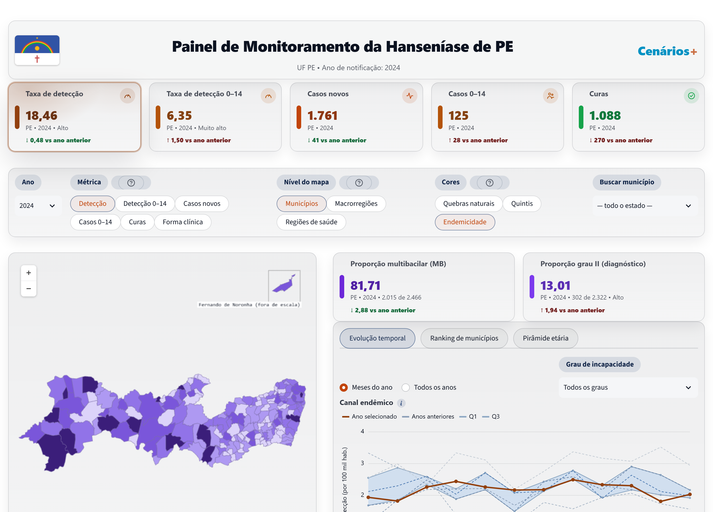
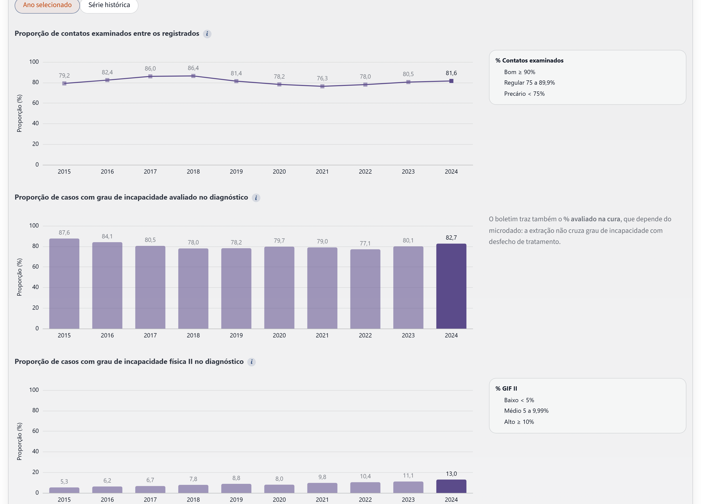

# Painel de Monitoramento da Hanseníase — Pernambuco

[](https://github.com/Dev-Cenarios/painel-hanseniase-pernambuco/actions/workflows/ci.yml)


Painel de vigilância epidemiológica da hanseníase em Pernambuco, com recorte
por **município**, **região de saúde** e **macrorregião de saúde**, para a
Secretaria Estadual de Saúde e para as equipes de vigilância dos municípios.

**No ar:** <https://painel.cenarios.unb.br/cenarios/hansepe/>



## Sumário

- [Visão geral](#visão-geral)
- [O que o painel mostra](#o-que-o-painel-mostra)
- [Como os números são calculados](#como-os-números-são-calculados)
- [Dados](#dados)
- [Instalação e execução](#instalação-e-execução)
- [Testes](#testes)
- [Estrutura do repositório](#estrutura-do-repositório)
- [Manutenção](#manutenção)
- [Documentação](#documentação)
- [Família Cenários+](#família-cenários)
- [Fontes e créditos](#fontes-e-créditos)
- [Como citar e licença](#como-citar-e-licença)

## Visão geral

O painel responde, para qualquer território de Pernambuco e qualquer ano
desde 2010, às perguntas que a vigilância da hanseníase faz primeiro: qual a
taxa de detecção, quantos casos novos (no geral e em menores de 15 anos),
quantos são multibacilares, quantos chegam ao diagnóstico já com grau II de
incapacidade e quantos se curam — e como isso se distribui no mapa, no tempo,
por idade e pelos campos da ficha de notificação.

Nasceu do painel em R/Shiny da equipe parceira. Mantém a organização de tela
e a linguagem visual de lá, mas os casos novos seguem a definição do
Ministério da Saúde, e não o total de entradas. Essa e as outras diferenças
estão escritas, com o motivo e o tamanho de cada uma, em
[`docs/paridade-hanseniase.md`](docs/paridade-hanseniase.md).

## O que o painel mostra

| Bloco | Conteúdo |
|---|---|
| **Indicadores** | Sete cards do ano e território selecionados, com a variação contra o ano anterior: taxa de detecção geral e em menores de 15 anos, casos novos (geral e de 0 a 14), curas, proporção de multibacilares e proporção de grau II no diagnóstico. Nas proporções, o card mostra a conta de onde o número sai (ex.: "302 de 2.322"). |
| **Mapa** | Coroplético clicável por município, região de saúde ou macrorregião. Três formas de colorir: a **escala de endemicidade** do Ministério (o padrão), quintis e quebras naturais. Seis métricas: detecção, detecção 0–14, casos novos, casos 0–14, curas e forma clínica. |
| **Evolução temporal** | Canal endêmico (ano selecionado sobre a faixa dos cinco anos anteriores), com filtro por grau de incapacidade; série anual e epicurva mensal desde 2010. |
| **Ranking e pirâmide** | Os municípios do recorte ordenados pela métrica do mapa, e os casos por sexo e faixa etária. |
| **Qualidade do programa** | Os quatro indicadores da Tabela 2 do boletim estadual — cura, abandono, contatos examinados e grau de incapacidade avaliado —, cada um com os parâmetros do Ministério ao lado. |
| **Tópicos de interesse** | Dezesseis variáveis da ficha de notificação (modo de detecção, classificação operacional, forma clínica, baciloscopia, raça/cor…). |

**Tudo segue o clique.** Entrar numa macrorregião, numa região de saúde ou
num município recalcula os cards e todos os gráficos para aquele território,
somando os municípios e recalculando as taxas — nunca tirando média de taxas.



## Como os números são calculados

| Indicador | Cálculo |
|---|---|
| Taxa de detecção (por 100 mil) | casos novos ÷ população |
| Taxa de detecção 0–14 (por 100 mil) | casos novos de 0 a 14 ÷ população de 0 a 14 |
| Casos novos | notificações com modo de entrada "caso novo" |
| Casos novos de 0 a 14 | notificações na faixa etária |
| Curas | saídas por cura registradas no ano |
| Proporção de multibacilares (%) | MB ÷ (PB + MB) |
| Proporção de grau II no diagnóstico (%) | grau II ÷ casos com avaliação registrada |

Regras que valem em todo o painel: recorte por **município de residência**;
regiões calculadas da **soma** dos municípios; ano incompleto **detectado**
pelos meses com dado, não presumido. Cura, abandono e contatos examinados
ficam ocultos nos anos em que menos da metade dos casos já tem saída de
tratamento registrada — o número descreveria o calendário, não o programa.

A conta completa de cada indicador e o que ela ainda não consegue fazer
(curas por coorte, por exemplo, que exigem o microdado):
[`docs/metodologia.md`](docs/metodologia.md).

## Dados

A extração **agregada** do SINAN produzida pela equipe parceira — a mesma que
serve o painel nacional —, só com as partições de hanseníase, em parquet com
particionamento Hive. Mais as malhas municipais e a hierarquia de regiões de
saúde da SES-PE em `data/support/`. O painel não usa o SIM.

- **Nenhum dado nominal ou identificável entra no projeto.** Tudo chega já
  somado por município, ano e categoria.
- **Os dados não estão no repositório.** A extração é da equipe parceira e
  não é nossa para publicar. Quem for rodar o painel pede a extração à
  equipe do Cenários+.
- `data/` tem cerca de 47 MB, copiados do acervo do painel nacional por
  `python -m scripts.extrair_dados_hanseniase`. É cópia: quando a extração
  for atualizada, rode o script de novo; `data/PROCEDENCIA.json` diz de onde
  veio e quando.
- Cobertura: 2010 a 2025 completos; 2026 aparece na série mensal, mas ainda
  não é oferecido no seletor de ano.

Quais arquivos o painel abre, quais campos da ficha usa e o caminho dos dados
até a tela: [`docs/requisitos.md`](docs/requisitos.md).

## Instalação e execução

Requisitos: Python 3.13 e a extração de dados (ver acima).

```bash
git clone https://github.com/Dev-Cenarios/painel-hanseniase-pernambuco.git
cd painel-hanseniase-pernambuco
python -m venv .venv && .venv/Scripts/activate        # Linux/macOS: source .venv/bin/activate
pip install -r requirements.lock.txt
python -m scripts.extrair_dados_hanseniase --origem <pasta da extração>
streamlit run app.py
```

O painel abre em <http://localhost:8501>.

Sem `--origem`, o script procura a extração em `../sinan/data`, que é onde
ela fica quando o painel nacional está clonado ao lado deste. Se os dados
estiverem em outro lugar e você não quiser copiar, aponte direto para eles
com a variável `SINAN_DATA_DIR`.

Para subir como no servidor, com Docker:

```bash
docker compose up -d --build
```

## Testes

```bash
pytest                                   # ~440 testes com os dados (~45 s)
ruff check --select F app.py src tests   # nome indefinido, import quebrado, código morto
```

Sem os dados, `pytest` roda só o que não depende deles — tema, navegação,
componentes, montagem das opções dos gráficos — e diz o que pulou. É o que o
CI faz a cada push, junto com a construção da imagem Docker.

A suíte cobre, entre outras coisas: as fórmulas de cada indicador; a soma
regional batendo com o card da região; a **paridade** com o painel de origem
e com o boletim estadual de 2024, município a município (`tests/paridade/`);
a lista de variáveis do `contrato-dados.md` contra o que o código lê; e a
tela inteira por `AppTest`, em todos os níveis de navegação.

## Estrutura do repositório

```
painel-hanseniase-pernambuco/
├── app.py                        composição da tela
├── src/
│   ├── estado.py                 navegação PE → macro → região → município
│   ├── mapa.py · mapa_componente.py   o mapa em deck.gl
│   ├── componente_mapa/          deck.gl vendorado + protocolo do Streamlit
│   ├── grafico_componente.py     os gráficos como opções ECharts
│   ├── componente_grafico/       ECharts vendorado + protocolo do Streamlit
│   ├── resiliencia.py            uma falha num bloco não derruba a página
│   ├── data/                     escopo, leitura, kpis, canal, recortes, geo
│   ├── doencas/hanseniase.py     o pack da doença
│   └── theme/                    identidade visual
├── tests/                        suíte pytest, com tests/paridade/
├── scripts/                      dados, geometria, boletim, prévia do link
├── docs/                         metodologia, paridade, requisitos, contrato de dados
├── assets/                       bandeira de PE, marca e prévia do link
├── .github/workflows/ci.yml      CI
├── Dockerfile · docker-compose.yml
└── requirements.txt · requirements.lock.txt
```

## Manutenção

- **Nova extração de dados:** rodar `python -m scripts.extrair_dados_hanseniase`
  de novo e reiniciar; nada no código depende do ano.
- **Novo boletim estadual:** `python -m scripts.extrair_tabela_boletim`
  refaz a referência de `tests/paridade/`, que é contra o que o painel é
  conferido.
- **Mudou `mapa.js` ou `grafico.js`:** rodar `python -m scripts.versionar_js`.
  O Streamlit serve `.js` de componente com cache, e o carimbo `?v=<hash>`
  é o que faz o navegador baixar o arquivo novo (o teste cobra).
- **Prévia do link** (o cartão que aparece no WhatsApp, Slack e Teams):
  `python -m scripts.preparar_preview` gera `assets/preview.png`, e o
  Dockerfile injeta título e descrição na página.

## Documentação

| Arquivo | Para quem | O que tem |
|---|---|---|
| [`metodologia.md`](docs/metodologia.md) | quem lê o painel | a regra de cálculo de cada número |
| [`paridade-hanseniase.md`](docs/paridade-hanseniase.md) | quem compara com outra fonte | onde e por que o painel difere da origem e do boletim |
| [`requisitos.md`](docs/requisitos.md) | quem instala | máquina, de onde vêm os dados e como chegam |
| [`contrato-dados.md`](docs/contrato-dados.md) | quem mantém o código | o que pedir ao banco e as armadilhas da extração |
| [`performance.md`](docs/performance.md) | quem mantém o código | quanto custa cada leitura e o que foi feito |
| [`mapa-clique.md`](docs/mapa-clique.md) | quem mantém o código | como o clique no mapa foi resolvido |
| [`paridade-com-o-painel-r.md`](docs/paridade-com-o-painel-r.md) | quem mantém o código | as decisões do canal endêmico herdadas do RecifeTB |

## Família Cenários+

Este painel é um de três construídos sobre a mesma base e a mesma
identidade, e as melhorias circulam entre eles:

| Painel | Recorte | Repositório |
|---|---|---|
| Hanseníase — Pernambuco (este) | estado, por município e região de saúde | [Dev-Cenarios/painel-hanseniase-pernambuco](https://github.com/Dev-Cenarios/painel-hanseniase-pernambuco) |
| Tuberculose — Pernambuco | estado, por município e região de saúde | [Dev-Cenarios/painel-tuberculose-pernambuco](https://github.com/Dev-Cenarios/painel-tuberculose-pernambuco) |
| Tuberculose — Recife | cidade, por bairro e distrito sanitário | ainda não publicado |

## Fontes e créditos

- **Dados:** SINAN — Ministério da Saúde; população — IBGE; hierarquia de
  regiões e macrorregiões de saúde — Secretaria Estadual de Saúde de
  Pernambuco. Referência externa: Boletim Epidemiológico de Hanseníase da
  SES-PE. Dados preliminares, sujeitos a alteração: o SINAN é atualizado
  retroativamente.
- **Origem:** painel de monitoramento da hanseníase em R/Shiny, da equipe
  parceira do projeto Cenários+ (UnB).
- **Desenvolvimento:** projeto Cenários+ — Universidade de Brasília.

## Como citar e licença

Se usar o painel ou o código num trabalho, use o botão **"Cite this
repository"** aqui no GitHub, que lê o [`CITATION.cff`](CITATION.cff).

O código é aberto, sob a licença [MIT](LICENSE): pode ser usado, copiado e
adaptado, desde que o aviso de copyright do Projeto Cenários vá junto. A
licença vale para o código. Os dados são do Ministério da Saúde, do IBGE e
da SES-PE, e seguem as regras de cada fonte.
